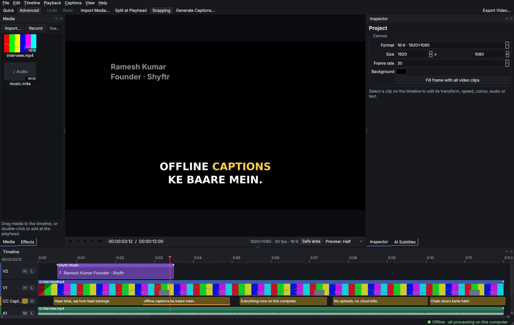
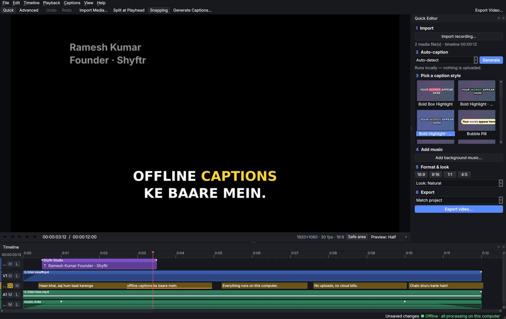
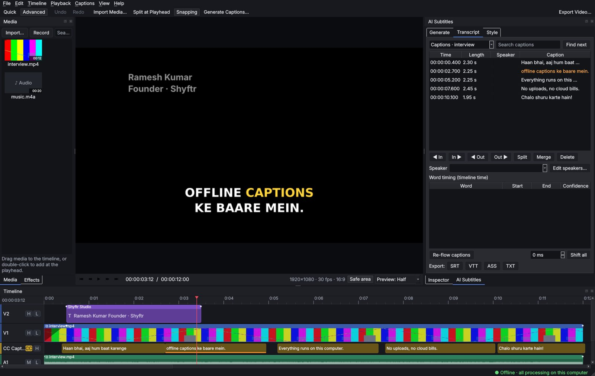
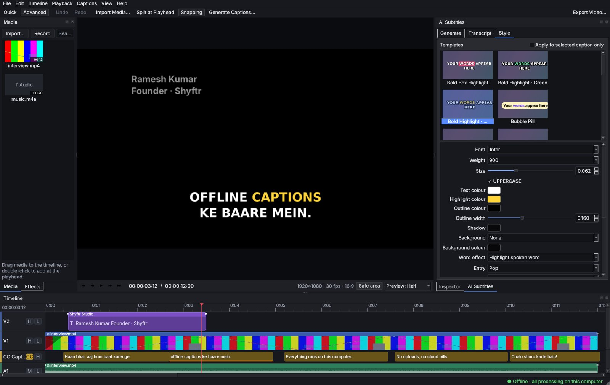

# Shyftr Studio

An offline desktop video editor for Windows and macOS. Its flagship feature is **automatic, template-based subtitles that are transcribed on your own computer**.

> "Import a recording, choose a caption style, and export a professional result — without sending a single frame to the cloud."

This repository implements the **P0 / MVP scope** of *Offline Desktop Video Editor — Enterprise Product and Technical Plan v1.0* in Qt 6 and C++. It covers the full P0 editor (multitrack timeline with trim, split and ripple, plus autosave and recovery) and the complete local subtitle pipeline.



| Quick Editor | Transcript editor | Caption styles |
|---|---|---|
|  |  |  |

*(Screenshots were captured headless with a generated test pattern; on macOS the viewer shows your video.)*

---

## Quick start (macOS, Apple Silicon)

```bash
# 1. Tools (one time)
brew install qt cmake ninja ffmpeg whisper-cpp

# 2. Build + test
cd ~/Projects/ShyftrStudio
./scripts/build-mac.sh            # configures, builds, runs the test suite

# 3. Run
open "build/Shyftr Studio.app"

# 4. Speech model (one time, ~466 MB; the only step that uses the internet)
./scripts/get-model.sh small      # downloads ggml-small.bin and prints its SHA-256
#    then in the app: Preferences → AI Models → Add model file…
```

After step 4 everything (editing, transcription and export) works with Wi-Fi turned off.

Windows: see `scripts/build-windows.ps1` and [docs/BUILD.md](docs/BUILD.md).

---

## What's implemented (mapped to the plan)

### 01 Editing: P0 core
| Area | Implemented |
|---|---|
| Timeline | Unlimited video/audio tracks; move (with snapping) across tracks; trim edges; split (one clip / all tracks); ripple delete; linked audio/video with unlink (Alt-drag ignores links); cut/copy/paste/duplicate; track mute/lock/hide; in/out range; zoom/scroll; next/previous edit |
| Video | Crop, fit/fill/stretch to any aspect ratio, scale, position, free and 90° rotation, flips, opacity, speed 0.1–16× (audio pitch preserved), fades in/out, cross-dissolve (overlapping tracks) and dip-to-black |
| Audio | Gain per clip and per track, fades, mute, waveforms, voice-over recording |
| Text | Titles (font, weight, size, colours, outline, box, position, align, fade/slide/pop/typewriter), lower-third/centre/top presets, shapes (rectangle/ellipse/line), editable subtitle tracks |
| Colour | Exposure, contrast, saturation, white balance (temperature/tint) + one-click looks |
| Output | 720p / 1080p / 4K and 9:16 / 1:1 / 4:5 presets, H.264/HEVC, hardware or software encoder, CRF or bitrate, range export, progress, ETA, cancel, error report + log |
| Projects | Local folder + versioned JSON, atomic save, rotating backups, rolling autosave, crash recovery, undo/redo, media relinking, collect media, portable package |

### 02–03 Flagship subtitles
- **Import → Transcribe → Align → Choose style → Customise → Render**, both as a one-click Quick Editor flow and in the AI Subtitles workspace.
- Local **whisper.cpp** transcription (run as an isolated process) with progress, cancel, retry and clear errors. Languages: Auto, **English, Hindi (Devanagari), Hinglish (Roman script), Punjabi (Gurmukhi)** and 10 more. A custom vocabulary field improves names and brands.
- Per-word timestamps and confidence. Low-confidence words are highlighted for review.
- An energy-based **word-timing refiner** (speech-onset snapping, silence trimming, monotonic/minimum-length rules) behind a pluggable interface. The optional Silero VAD model is supported.
- **Editable transcript** synced with playback: search, edit text, split/merge/delete captions, nudge in/out by a frame, per-word text and timing, speakers (manual labelling), global sync offset, re-flow.
- **18 caption templates** across the six families in the plan (Bold highlight, One-word pop, Karaoke fill, Minimal clean, Cinematic, Speaker labels, plus creator styles). Every style property is editable, per-caption overrides are supported, and you can save brand presets.
- Caption-safe positions for 16:9, 9:16 and 1:1. Templates change instantly without re-transcribing, and **user corrections survive template changes**.
- **Captions stay anchored** to the spoken words when clips are trimmed, split, moved, sped up or deleted. Mapping is computed through the clips that use the source media.
- Burn-in export plus **SRT, WebVTT (with word timestamps) and ASS (styled, with \k karaoke)**. SRT/VTT import is supported.
- **Preview/export parity:** the same renderer draws captions in the viewer and in the exported file, and an automated test compares exported frames with the preview pixel by pixel.

### 04–08 Architecture, security, formats
- 100% local: no database, account, telemetry or network calls (see [docs/PRIVACY.md](docs/PRIVACY.md)).
- Model manager: offline model packs with SHA-256 recorded at import, provenance, tamper detection, disk-space checks and a size/RAM guide.
- Workspace layout as specified: `ShyftrStudio/{Projects, AI_Models, User_Templates, User_Preferences}` and per-project `media, subtitles, templates, thumbnails, proxies, waveforms, autosaves, exports`.
- Mixed and variable frame-rate sources are conformed to the project time base, using integer microsecond timing so long timelines don't drift.
- Optional admin policy file (`User_Preferences/policy.json`) for default export settings, cache retention and model import control.

### 06 Workspaces
Welcome/Projects (new, recent, recovery, relink) · Quick Editor · Advanced Editor (dockable media bin, viewer, inspector, timeline, effects browser) · AI Subtitles · Audio controls · Colour controls · Export Center · Preferences (tools, AI models, GPU/encoder, shortcuts, privacy, accessibility). Every shortcut is remappable, and there is a high-contrast theme and text scaling.

---

## Not in this release
These items are deliberately left to later releases (P1/P2 in the plan): keyframe animation, proxies, nested timelines, curves/LUTs/scopes, noise removal and EQ, automatic speaker diarization (manual labelling is included), offline translation, OpenTimelineIO, encrypted bundles, signed installers and offline licensing. See [docs/ARCHITECTURE.md](docs/ARCHITECTURE.md#roadmap-hooks) for the extension points.

## Documentation
- [docs/BUILD.md](docs/BUILD.md): building on macOS and Windows, and bundling the engines
- [docs/ARCHITECTURE.md](docs/ARCHITECTURE.md): layers, data model, render pipeline, design decisions
- [docs/USER_GUIDE.md](docs/USER_GUIDE.md): workflows and keyboard shortcuts
- [docs/TESTING.md](docs/TESTING.md): automated tests, release acceptance checklist, language evaluation
- [docs/PRIVACY.md](docs/PRIVACY.md) · [docs/TROUBLESHOOTING.md](docs/TROUBLESHOOTING.md)

## Licensing note
Before any commercial release, review the licences in the plan's licensing gate: Qt (LGPLv3, dynamically linked here), FFmpeg (separate executable; its licence depends on how it was built, and Homebrew's build is GPL), whisper.cpp (MIT), the model weights, and fonts (none are bundled; templates use system fonts).
